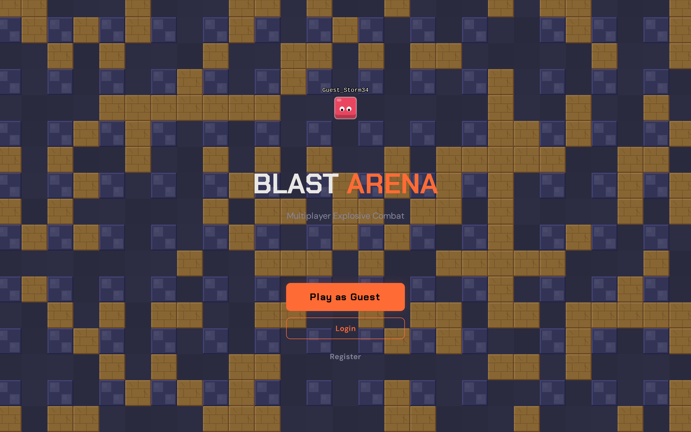
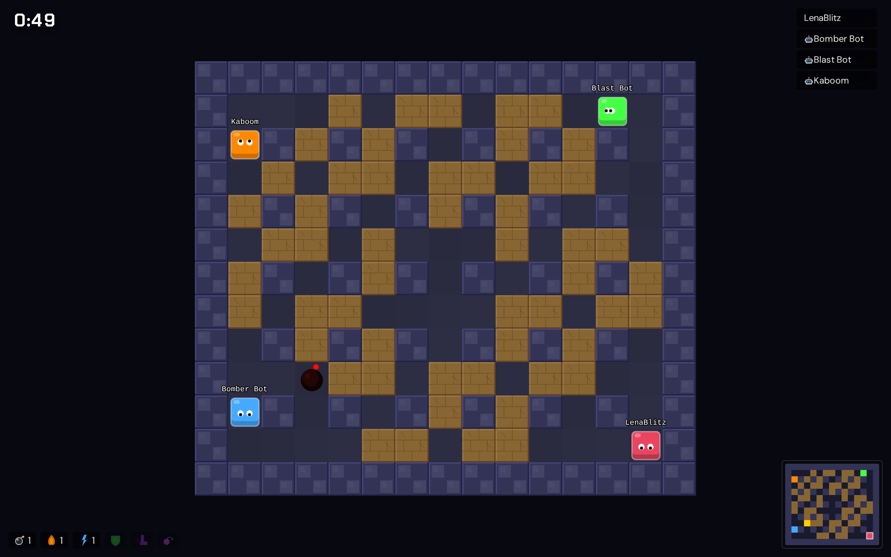
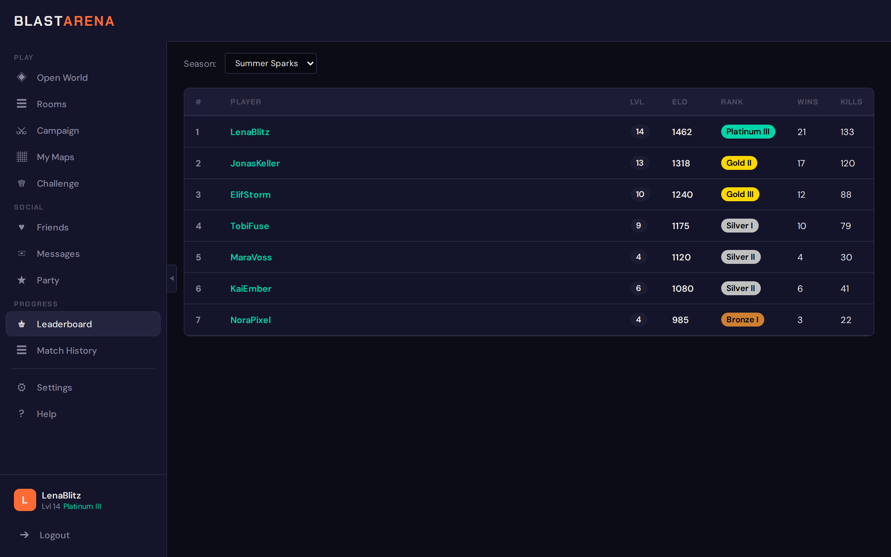
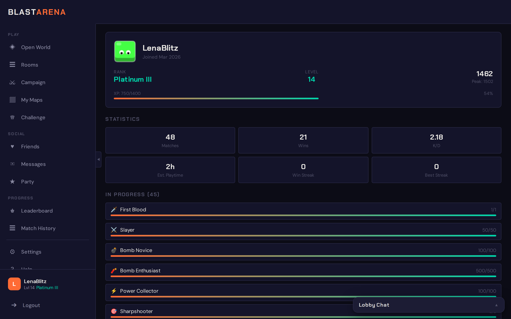
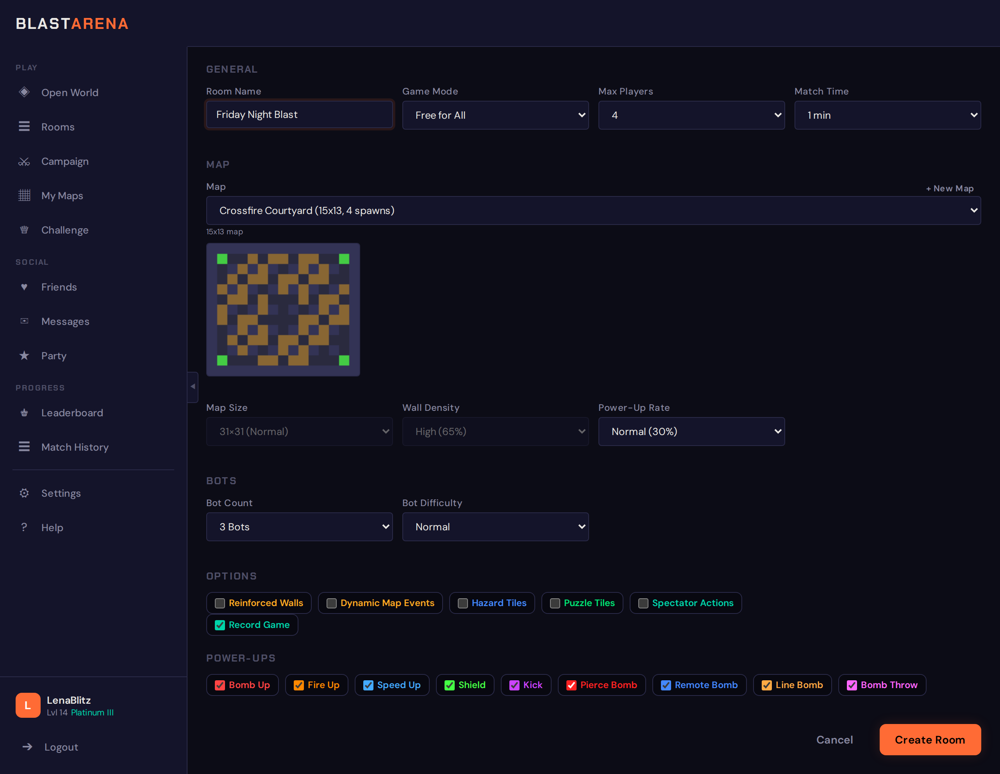
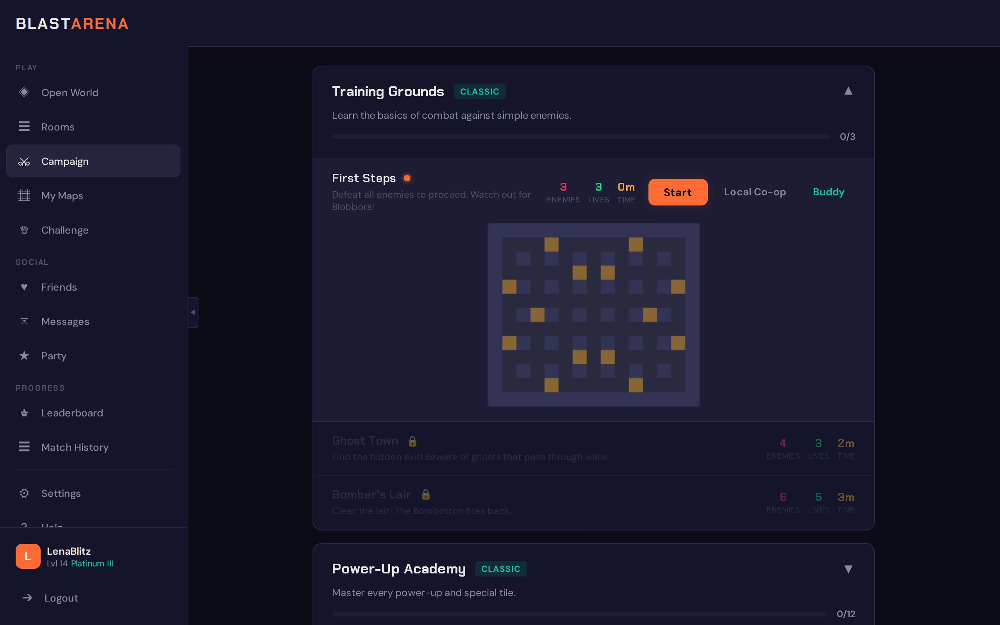
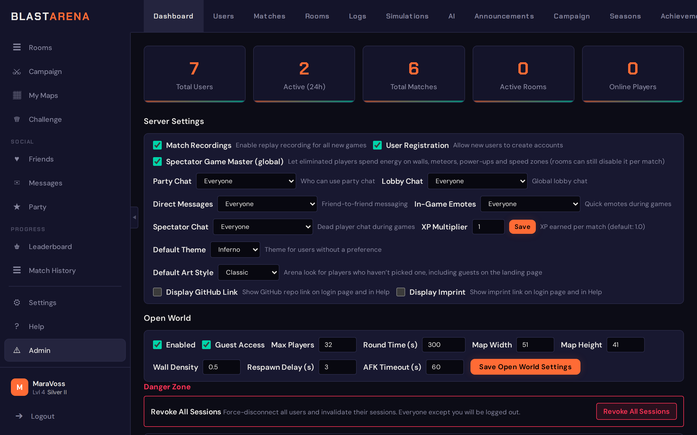

# BlastArena

A multiplayer bomb arena game for the browser, built with Phaser and Node.js. 2–8 players, with bots filling the gaps, fight on a destructible grid in six game modes. Around that: a persistent open world, a campaign with a level editor, and full admin tools.



**Status:** in production at [www.blastarena.at](https://www.blastarena.at/) and actively developed; Open World mode is still a work in progress.

<p>
  
  
  
  
  
  
</p>

Every screen, with a sentence each: [screenshot gallery](docs/screenshots/README.md). The landing page [in German](docs/screenshots/menu-landing.de.png); the lobby [on a phone](docs/screenshots/lobby-openworld.mobile.png).

**Contents:** [Quick Start](#quick-start) · [Game Modes](#game-modes) · [Controls](#controls) · [Power-Ups](#power-ups) · [Map Features](#map-features) · [Open World](#open-world-mode-wip) · [Campaign](#campaign) · [Custom Maps](#custom-maps) · [Bot AI](#bot-ai) · [Progression](#progression) · [Social](#social-features) · [Look & Feel](#look--feel) · [Account & Security](#account--security) · [Admin Panel](#admin-panel) · [Replays](#game-replays) · [In-Game Help](#in-game-help--documentation) · [Languages](#internationalization) · [Architecture](#architecture) · [Tech Stack](#tech-stack) · [Testing](#testing--linting) · [Documentation](#documentation)

## Quick Start

```bash
# Clone and configure
cp .env.example .env
# Edit .env — production requires DB_PASSWORD, DB_ROOT_PASSWORD, JWT_SECRET,
# EMAIL_PEPPER (each >=32 chars) and TOTP_ENCRYPTION_KEY (exactly 64 hex chars,
# because it is an aes-256-gcm key). Generate any of them with: openssl rand -hex 32

# The backend runs as uid 1000 and writes to five bind-mounted directories. Create them
# owned by that uid (Docker would create them as root). Never chown all of data/:
# data/db and data/redis belong to the database containers (uid 999).
mkdir -p data/gamelogs data/simulations data/replays data/ai data/enemy-ai
sudo chown -R 1000:1000 data/gamelogs data/simulations data/replays data/ai data/enemy-ai

# Production (default)
docker compose up --build -d

# Development (hot reload) — or `npm run dev`
# The `-p` is MANDATORY: without it this adopts and replaces the production containers.
docker compose -p blast-arena-dev -f docker-compose.yml -f docker-compose.dev.yml up --build
```

- **Dev and production side by side:** the dev stack has its own Compose project, container names, host ports (nginx `8285`, Vite `5183`, DB `3317`, Redis `6390`) and data directory (`./data-dev`).
- **Production networking:** Nginx binds to `127.0.0.1:8280` (loopback only) and expects a host-level reverse proxy that terminates TLS. For local use, open the proxied port or forward `127.0.0.1:8280`.
- **Configuration:** every option is listed in `.env.example`.

### First admin

There is no default account. Register through the app. Without SMTP settings the verification email is only logged, not sent, so verify and promote the first admin in the database:

```bash
docker compose exec db mariadb -u blast_user -p blast_arena \
  -e "UPDATE users SET email_verified = TRUE, role = 'admin' WHERE username = 'yourname'"
```

Admins can then create further (already verified) accounts in Admin → Users.

### Upgrading MariaDB

The `db` service sets `MARIADB_AUTO_UPGRADE=1`, so the container upgrades `data/db` in place on its first start after a major-version bump. Take a verified dump first (`docker compose exec db mariadb-dump ...`): a major-version upgrade cannot be rolled back.

## Game Modes

| Mode | Players | Duration | Description |
|------|---------|----------|-------------|
| **Free for All** | 2-8 | 3 min | Last player standing wins |
| **Teams** | 4-8 | 4 min | Two teams — last team standing. Friendly fire configurable |
| **Battle Royale** | 4-8 | 5 min | Circular danger zone shrinks inward |
| **Sudden Death** | 2-8 | 2 min | Start fully powered, no power-ups, one hit kills |
| **Deathmatch** | 2-8 | 5 min | Respawn after death, first to 15 kills wins |
| **King of the Hill** | 2-8 | 4 min | Control the 3x3 zone (moves every 30s with warning), 2 pts/tick, first to 100 points |

## Controls

| Keyboard | Gamepad | Action |
|----------|---------|--------|
| `WASD` / `Arrow Keys` | D-Pad / Left Stick | Move |
| `Space` | A | Place bomb |
| `E` | B | Detonate remote bombs / Toggle FIFO mode |
| `Q` | Y | Throw bomb (with Bomb Throw power-up) |
| `1`-`6` | — | Quick emote (when alive) |
| `` ` `` (backtick) | Y | Open emote wheel (right stick to aim, A to confirm) |
| `Escape` | Start | Pause (campaign) / Leave game (multiplayer) |
| `1`-`9` | LB / RB | Spectate player (when dead) |

- **Kick:** with the Kick power-up, walk into a bomb to send it sliding.
- **Follow a player:** click their name in the HUD while spectating.
- **Leaving:** Escape in a multiplayer game opens the leave menu. Leaving kills your player at once and returns you to the lobby.
- **Bots only:** when every human has left, the remaining bot match runs at 5× speed and the room disappears from the lobby.

## Power-Ups

| Name | Effect |
|------|--------|
| **Bomb Up** | +1 max bombs (up to 8) |
| **Fire Up** | +1 explosion range (up to 8) |
| **Speed Up** | Faster movement (up to 3 levels) |
| **Shield** | Absorbs one hit from any source (no time limit, doesn't stack) |
| **Kick** | Walk into bombs to kick them |
| **Pierce Bomb** | Explosions pass through destructible walls |
| **Remote Bomb** | Bombs wait for `E`, which detonates them all (10 s safety limit). `E` with no bombs out toggles FIFO mode (oldest first) |
| **Line Bomb** | Places a line of bombs in facing direction |
| **Bomb Throw** | `Q` throws a bomb up to 3 tiles ahead, over walls and obstacles. Over a run of walls it flies on to the first open tile |

Killed players drop one random collected power-up where they died. All power-up icons are drawn procedurally (no emoji), so they look the same on every platform.

## Map Features

All optional and toggled per room; each event type, hazard type and puzzle category can be picked on its own.

- **Reinforced walls:** destructible walls that take two hits.
- **Hidden tiles:** special tiles and power-ups can sit under destructible walls and appear when the wall is destroyed.

### Map events

| Event | What happens |
|-------|--------------|
| **Meteor strike** | A 2-second warning (pulsing crosshair, exclamation mark, growing shadow), then a falling meteor with screen shake and particles |
| **Power-up rain** | Power-ups rain down every 60 s |
| **Wall collapse** | A dust warning, then a 3x3 area is destroyed |
| **Freeze wave** | A row or column turns to ice for a while |
| **Bomb surge** | Every bomb's fuse gets shorter, with a screen pulse |
| **UFO abduction** | A tractor-beam warning, then a random player is teleported elsewhere and is briefly invulnerable |

### Hazard tiles

Placed on the map in clustered groups.

| Tile | Effect |
|------|--------|
| **Teleporter pair** | Transports between its A and B tiles |
| **Conveyor belt** | Animated stripes; pushes players and bombs along |
| **Vine** | Slows movement |
| **Mud** | Slows movement |
| **Quicksand** | Slows you and kills over time |
| **Ice** | You slide with momentum |
| **Lava** | Kills instantly and detonates adjacent bombs |
| **Spikes** | Cycle between safe and lethal phases |
| **Dark rift** | Teleports you to a random tile |

### Puzzle tiles

In the campaign and in multiplayer. Multiplayer places them procedurally from the categories the room picks (switches & gates, crumbling floors).

- **Switches:** colour-coded, in three kinds: toggle, pressure plate and one-shot. Each opens and closes the gates of its colour.
- **Gates:** explosions pass through them, open or closed.
- **Crumbling floors:** collapse into pits after being stepped on.

Together they make bomb-triggered switches, timed pressure-plate rushes and path-planning puzzles.

## Open World Mode (WIP)

A persistent bomb arena and the default landing page. Visitors join automatically on page load, with no room to create, and guests play without an account.

- **Toroidal map:** a wrapping 51x41 grid without border walls. Players, bombs and explosions wrap across the edges, so the world feels endless.
- **Ghost rendering:** the tilemap and every entity (players with shields and labels, bombs, explosions, power-ups) draw ghost copies at the edges, so wrapping looks seamless.
- **Guest play:** visitors without an account jump in from the menu screen.
- **Rounds:** configurable length (default 5 minutes), a freeze between rounds, and a new map each round.
- **Live scoring:** stats update in real time and are saved to the database periodically.
- **Remote bombs:** detonate FIFO (oldest first) by default; detonating with none placed switches to all at once. Chain reactions always spread between adjacent bombs.
- **Explosion performance:**
  - same-frame explosions share one louder sound
  - a particle budget degrades gracefully (20/40 emitter caps)
  - screen shake is coalesced
  - audio and shake use the wrapped distance near the edges
- **AFK timeout:** idle players are kicked after 60 s by default (admin: 0–600 s, 0 disables). Registered users keep the XP they earned.
- **Round counter:** shown on the round timer.
- **Live scoreboard:** replaces the player list (rank, name, kills/deaths, score) and highlights your row, even below the visible cut-off. Kills move it instantly; a full snapshot re-syncs every 5 s.
- **End-of-round standings:** the final top 10 over the frozen arena, with a countdown to the next round.
- **Admin controls:** on/off, round length, map settings and AFK timeout. The settings are prefixed `open_world_` in the admin dashboard and all hot-reload.

## Campaign

Hand-crafted levels in themed worlds: defeat enemies, earn 1–3 stars per level and track your progress. Details: [docs/campaign.md](docs/campaign.md) and [docs/enemy-ai-guide.md](docs/enemy-ai-guide.md).

- **9 world themes**, each with its own palette and tile textures: classic, forest, desert, ice, volcano, void, castle, swamp, sky.
- **Bundled content:** "Training Grounds" (3 intro levels) plus 8 tutorial worlds (21 levels) covering every power-up, hazard tile, special tile and puzzle mechanic.
- **Level flow:**
  - selecting a level shows a themed pixel-art map preview
  - a 3-2-1-GO countdown, then a pause menu on Escape (Continue/Exit)
  - a short grace period after a win, and retry or play again in the same mode

### Play modes

- **Solo.**
- **Online co-op:** two players in a party.
- **Local co-op:** two players on one keyboard or on gamepads.
  - Player 2 joins as a guest (own name and colour) or logs in with their own account and cosmetics; the session persists via cookie.
  - Control presets: WASD, Arrows, Numpad, Gamepad 1, Gamepad 2.
  - Camera: shared auto-zoom, or horizontal or vertical split-screen. Split-screen zooms each viewport and points an arrow at an off-screen partner, on the line between the two players.
- **Buddy mode:** for very young or new players. The buddy is a smaller, permanently invulnerable helper.
  - It passes through destructible walls and bombs, picks up power-ups for P1 and places limited bombs (1 bomb, range 1).
  - Name, colour and size (40–80%) are saved per account, in Settings > Preferences or the launch modal.

### Enemies and the level editor

- **Visual editor (admins):** resizable maps, WASD/arrow panning, zoom and clear spawn markers. Levels and enemy types export and import as JSON, AI source included.
- **Enemy looks**, all with live preview:
  - 6 body shapes: blob, spiky, ghost, robot, bug, skull
  - 4 eye styles and 8 add-ons: teeth, horns, tail, aura, crown, scar, wings, accessories (bow tie, monocle, bandana)
  - primary and secondary colour, and a size multiplier
- **Enemy behaviour:** 5 built-in movement patterns and boss phases. Alternatively a custom AI script (a TypeScript `decide()` method), uploaded in the AI tab and assigned per enemy type with a difficulty.
- **6 bundled enemy AIs**, each scaling across easy, normal and hard:

| AI | Behaviour |
|----|-----------|
| Hunter | Aggressive chaser |
| Patrol Guard | Follows a path |
| Bomber | Area denial |
| Coward | Flees and sets traps |
| Swarm | Coordinated flanking |
| Ambusher | Waits, then rushes |

## Custom Maps

Any signed-in player can design maps for multiplayer rooms in the built-in editor (adapted from the campaign editor): walls, destructible blocks, spawn points, teleporter pairs and conveyor belts. Maps stay private or are published for the community.

- **My Maps** sidebar view: list, edit, publish/unpublish, delete your maps
- **Map picker** in room creation: your own maps and community maps, grouped. A custom map shows a pixel-art preview and turns off the map size and wall density settings
- **Validation**: odd dimensions (9-51), border walls, 2-8 spawn points and valid tile types, checked in the client and on the server
- **Play count**: each game on a custom map counts toward it
- **Community ratings**: 1-5 stars on published maps; the community list sorts by average rating, and the room dropdown shows the stars
- **Map challenges**: weekly admin-created challenges on a featured community map, with their own leaderboard (wins, kills, games played).
  - The lobby's Challenge view shows the map preview, a creator spotlight and the top scores. "Play Challenge" opens a room with map and mode locked.
  - Admins manage them in their own tab: one active at a time, plus a global toggle. Maps tied to an active or upcoming challenge can't be deleted.

## Bot AI

Three difficulty tiers, tuned over 20,000+ simulated games:
- **Easy**: Low awareness, shallow escape, intentional mistakes
- **Normal**: BFS pathfinding, dynamic danger assessment, competitive
- **Hard**: Deep search, chain reaction awareness, shield aggression, dominant

All bots share:
- **Team awareness:** in team mode they never hunt, bomb or kick teammates.
- **Power-up scoring:** shield > speed > kick/throw > pierce > remote/line > fire > bomb; maxed power-ups are skipped.

Admins can upload their own bot AIs as TypeScript files. Guides: [docs/bot-ai-guide.md](docs/bot-ai-guide.md) (writing one) and [docs/bot-ai-internals.md](docs/bot-ai-internals.md) (how the built-in AI decides).

## Progression

### Leaderboard & ranking

- **Elo** across all game modes: the standard formula with an adaptive K-factor.
- **Seasons:** admin-defined dates, archived history, hard or soft resets.
- **Rank tiers:** six (Bronze to Champion) with optional sub-tiers I/II/III, all admin-configurable.
- **Leaderboard view:** a season filter (hidden when there are no seasons); names open full-page profiles.
- **Badges:** rank and level next to usernames in the lobby. The game-over screen shows the Elo change and XP gained.
- **Match History** sidebar view: recent matches with mode, result, K/D, placement and duration, plus per-mode stats (win rate, average kills), paginated.

### XP & levels

Separate from Elo.

- **XP comes from** kills, bomb placements, power-ups, finishing matches and placement bonuses. Each level needs more XP than the last.
- **Rewards:** level milestones can unlock exclusive cosmetics. Admins set an XP multiplier.
- **Shown on** the leaderboard, profiles, the lobby and the game-over screen (with a progress bar).

### Achievements & cosmetics

- **Achievements:** four condition types (cumulative stats, per-game feats, mode milestones, campaign progress), admin-configurable. The default pack has 47 achievements and 25 cosmetic rewards across combat, victory, dedication, mode mastery and campaign.
- **Progress bars** for unfinished achievements on your own profile.
- **Cosmetics:** player colours, eye styles, movement trails and bomb skins. They unlock through achievements, campaign stars or level milestones, or are available by default.
- **Live preview** in Settings of the equipped player sprite, bomb and trail.
- **Profiles:** a full page with rank, level, stats grid, season history, achievements and equipped cosmetics, plus a privacy toggle.
- **Export/import** of achievements and cosmetics as JSON.

## Social Features

- **Friends**: a full-page view with tabs (Friends/Requests/Blocked), search, and friend cards with online status.
- **Online presence**: friends' live status (online, in lobby, in game, in campaign), tracked in Redis with a 120 s TTL.
- **Parties**: a full-page view: create a party, or see member cards, chat and invites. When the leader joins a room, all members follow.
- **Room invites**: invite friends to your current room; the invite toast has Accept/Decline and dismisses itself after 30 s.
- **Lobby chat**: a global, ephemeral chat in a collapsible panel at the bottom right. Users can hide it in Settings > Preferences > Chat.
- **Direct messages**: a two-column view (conversations + the open conversation). Persistent messages between friends, with unread badges, real-time delivery and read receipts.
- **In-game emotes**: 12 bubbles that float above the player, with a 3 s cooldown. Keys 1-6 send quick emotes; backtick (`) opens a radial wheel with all 12.
  - GG, Help!, Nice!, Oops, Taunt, Thanks, Wow, Sorry, Let's Go!, No!, Wait, Boom!
- **Spectator chat**: dead players chat during live games, in a collapsible panel at the bottom left, with role-coloured names and a 3 messages/s limit.
- **Spectator game master**: dead players gain energy (1/tick, max 100) and spend it on the live match. Admin global toggle plus a per-room setting.
  - Actions, from an action bar (Q/W/E/R) with click-to-place targeting: temporary wall (30 energy, 10 s), targeted meteor (50, 1.5 s warning), random power-up (40), speed boost or slow zone (25, 8 s).
  - Anti-griefing: 1 s cooldown, rate limits, no occupied tiles, nothing near spawns or allies.
- **Rematch voting**: after a game, more than 50% of votes restart it with the same settings (30 s timeout). Solo games (one human plus bots) show a "Play Again" button instead.
- **Admin chat controls**: party chat, lobby chat, DMs, emotes and spectator chat can each be set to everyone (default), staff only, admin only, or off.

## Look & Feel

- **11 colour themes** for the whole UI and the game canvas. Users pick one in Settings > Preferences; admins set the global default in the Dashboard.
  - Dark: Inferno, Arctic, Toxic, Crimson, Midnight
  - Vivid light: Daylight, Sakura, Sand
  - Pastel light: Frost, Blossom, Dune
- **4 art styles** for the arena: Classic, Neon Arena, Toy Diorama, Crisp Pixel. Each player picks one per device in Settings; admins set the default.
- **Graphics settings:** quality, sharp rendering (up to 2× pixel density), particles, animations, screen shake and the minimap. An OS "reduce motion" preference turns animations and shake off by default.
- **Colour-blind mode:** safe player and team colours, plus a shape marker per player.
- **Sidebar navigation:** a collapsible left sidebar with an "ear" toggle. Every lobby view opens inline in the main area, with no overlays. On phones the sidebar folds to an icon rail and opens as a drawer.
  - Views: Open World, Rooms, Create Room, Campaign, My Maps, Challenge, Friends, Messages, Party, Leaderboard, Match History, Profile, Settings, Help, Admin

## Account & Security

- **Two-factor authentication:** optional TOTP in Settings > Account.
  - Set up by scanning a QR code (or typing the secret) into any authenticator app, such as Google Authenticator, Authy or 1Password. Setup gives 10 one-time backup codes.
  - Login then asks for the 6-digit code; disabling needs the password and a code.
  - Secrets are encrypted at rest (AES-256-GCM). Admins see each user's 2FA status and can reset it in the Users tab.
- **Account deletion:** self-service in Settings > Account, confirmed by password. It removes all user data (stats, replays, maps, messages, friends). Admin accounts can't delete themselves.
- Security headers, rate limiting and validation: see [SEO & Web Standards](#seo--web-standards) and [Tech Stack](#tech-stack).

## Admin Panel

| Tab | Access | Key Features |
|-----|--------|-------------|
| Dashboard | Admin | Stats, server settings (recordings, registration, email/SMTP, chat modes, XP multiplier, default theme and art style, open world, GitHub/imprint display), game/simulation defaults (incl. puzzle tiles, spectator actions), revoke all sessions |
| Users | Staff | Search, roles, deactivate, delete (simple confirmation), password reset, revoke sessions, 2FA status & reset, bulk account cleanup (unverified/inactive/deactivated) |
| Matches | Staff | History, per-player stats, replay viewer, delete |
| Rooms | Staff | Live rooms, spectate, kick, force close |
| Logs | Admin | Audit trail with filters, click-to-expand detail rows |
| Simulations | Admin | Batch bot-only games (1-1000), fast/realtime, queue |
| AI | Admin | Upload/manage custom bot AI and enemy AI implementations |
| Announcements | Admin | Toast broadcasts, persistent banners |
| Campaign | Admin | Worlds, levels (visual editor), enemy types, JSON export/import, campaign replays |
| Seasons | Admin | Season CRUD, activate, end the active season (hard/soft Elo reset), rank tier config with color pickers |
| Achievements | Admin | Achievement CRUD (4 condition types), cosmetic CRUD (4 types), reward linking, JSON export/import |
| Challenges | Admin | Map challenge CRUD, activate/deactivate, global toggle, published map selection |

- **Imprint & GitHub links:** admin-toggled; shown in the login page footer and on the right of the Help tab bar.
  - The imprint text is edited in the Dashboard and opens as a modal on login or as a tab in Help.
- **Audit log:** every admin action is logged. See [docs/admin-and-systems.md](docs/admin-and-systems.md).

## Game Replays

- **Recording:** games are saved as gzipped JSON. Campaign games are recorded too, with enemies, when recordings are on.
- **Viewer:** video-player controls (play/pause, seek, 0.5-4x speed), a synced event log and click-to-follow spectating.
- **Where:** the Matches and Simulations tabs, and the Campaign tab's Replays view.

Details: [docs/replay-system.md](docs/replay-system.md).

## In-Game Help & Documentation

Full-page Help view accessible from the lobby sidebar. Seven tabs with role-based filtering:

| Tab | Access | Content |
|-----|--------|---------|
| Getting Started | All | Keyboard + gamepad controls, basic mechanics, spectator mode |
| Power-Ups | All | All 9 power-ups with Canvas2D inline sprites matching in-game textures |
| Game Modes | All | 6 modes with player counts, rules, win conditions |
| Map Features | All | Reinforced walls, dynamic events, hazard tiles with Canvas2D tile previews, theme variant showcase (all 9 campaign themes) |
| Guides | All | Rendered markdown docs: Campaign, Replays, Bot AI, Enemy AI (collapsible sections) |
| Level Editor | Staff | Visual tile reference (27 tile types with Canvas2D icons) + campaign system docs |
| Admin Docs | Staff | Admin systems, infrastructure, testing, performance, bot AI internals, API reference |

The backend serves the documentation from `docs/` (bind-mounted in dev, baked into the image for production); the client renders the markdown with `marked`.

## Architecture

```
                    ┌──────────────────┐
                    │      Nginx       │
                    │  (static files   │
                    │   + reverse      │
                    │     proxy)       │
                    └────────┬─────────┘
                             │
                    ┌────────▼─────────┐
       ┌───────────│     Backend      │───────────┐
       │           │  Express + TS    │           │
       │           │  Socket.io       │           │
       │           │  20 tick/s loop  │           │
       │           └──────────────────┘           │
       │                                          │
┌──────▼──────┐                          ┌────────▼────────┐
│   MariaDB   │                          │      Redis      │
│  (users,    │                          │  (sessions,     │
│   matches,  │                          │   rate limits)  │
│   actions)  │                          │                 │
└─────────────┘                          └─────────────────┘
```

- **Server-authoritative**: All game logic runs on the server at 20 ticks/sec
- **Grid-based movement**: Players occupy exactly one tile at a time
- **Procedural audio**: all SFX are synthesised with the Web Audio API (explosions, bombs, power-ups, death, countdown, victory/defeat), with no audio files. Sound toggle and volume in Settings
- **In-game minimap**: a Canvas2D overlay of tiles, players, bombs, explosions, zone boundaries and the KOTH hill; toggleable in Settings
- **Kill feed with cause**: Death causes tracked (bomb, zone, lava, quicksand, spikes, dark rift, self, disconnect) with icons in kill feed and death banner
- **Monorepo**: npm workspaces — `shared/` (types + constants), `backend/` (server), `frontend/` (client)
- **Self-hosted assets**: All fonts, sounds, and static resources served locally — no external CDN dependencies

## Internationalization

Full i18n via [i18next](https://www.i18next.com/). UI strings live in JSON locale files, and every key exists in all 12 languages (enforced by `tests/shared/localeParity.test.ts`).

All 12 are complete: English `en`, German `de`, French `fr`, Spanish `es`, Italian `it`, Portuguese `pt`, Polish `pl`, Dutch `nl`, Turkish `tr`, Swedish `sv`, Norwegian `nb`, Danish `da`.

- **Language selection**: a flag dropdown on the login screen and in Settings > Preferences. The browser language is detected on the first visit
- **Namespaces**:
  - shared: `common`, `game`
  - frontend: `ui`, `auth`, `admin`, `campaign`, `help`, `editor`, `errors`
  - backend: `server`, `email`
- **Email i18n**: every transactional email (verification, password reset, email change, warnings, test) goes out in the user's language
- **Adding a language**: add translated JSON files in `frontend/src/i18n/locales/{code}/`, `shared/src/i18n/locales/{code}/` and `backend/src/i18n/locales/{code}/`, then register the code in the i18n config files
- **RTL ready**: the document direction is set dynamically for RTL languages

## SEO & Web Standards

- Meta tags: description, keywords, Open Graph and Twitter Card (title and description; no preview image yet)
- JSON-LD structured data (`VideoGame` schema) for rich search results
- Self-hosted fonts (Chakra Petch + DM Sans) as woff2 in `frontend/public/fonts/`, critical fonts preloaded
- SVG favicon, web app manifest (PWA-ready), robots.txt, sitemap.xml
- Noscript fallback with branded content for JS-disabled crawlers
- Full security header suite: CSP (with Trusted Types, script hashes, frame-ancestors, upgrade-insecure-requests), HSTS, COOP, X-Frame-Options, Permissions-Policy — all self-hosted, no external domains
- Nginx rate limiting: API (30r/s), Socket.io (10r/s), auth (5r/s) — defense-in-depth with Express middleware
- Socket event validation: Zod schemas for room/admin events, bounds-checked game input, per-socket rate limiting on all lobby and admin actions
- Modals trap focus and close on Escape; lists, cards and dialogs are reachable by keyboard and gamepad

## Tech Stack

| Layer | Technology |
|-------|-----------|
| Frontend | Phaser 4 + TypeScript + Vite |
| Backend | Node.js 26 + Express 5 + TypeScript |
| Real-time | Socket.io |
| Database | MariaDB 12.3 + Redis 8 |
| Auth | JWT + bcrypt + httpOnly cookies, HMAC-SHA256 email hashing, email verification enforcement (max 3 resends), email enumeration prevention, optional TOTP 2FA |
| Security | CSP + HSTS + COOP + Trusted Types + upgrade-insecure-requests, parameterized queries, nginx + Express + socket rate limiting, Zod validation on REST + socket events, DOMPurify, email verification on REST + socket, atomic token operations, role-from-DB socket auth |
| Validation | Zod |
| Container | Docker Compose |

## Project Structure

```
blastarena/
├── shared/                  # Shared types, constants, utilities
├── backend/
│   └── src/
│       ├── routes/          # REST endpoints, one router per area
│       ├── handlers/        # Socket.io handlers (lobby, friends, party, DMs)
│       ├── game/            # Server game logic (GameLoop, GameState, BotAI, OpenWorldManager, …)
│       ├── simulation/      # Bot simulation system
│       ├── db/              # MariaDB connection, migrations, redis
│       ├── services/        # Business logic per feature
│       └── middleware/      # Auth, rate limiting, staff checks
├── frontend/
│   ├── index.html           # HTML shell, @font-face and the theme bootstrap script
│   ├── public/              # Static assets (favicon, fonts, robots.txt, sitemap, manifest)
│   └── src/
│       ├── styles.css       # Full CSS design system (11 themes)
│       ├── scenes/          # Phaser scenes (Boot, Menu, Lobby, Game, HUD, GameOver, LevelEditor)
│       ├── ui/              # DOM-based UI (Auth, Lobby views, Room, Campaign, Admin tabs, Help)
│       ├── art/             # Art styles (Canvas 2D painters), sharp rendering
│       ├── game/            # Client renderers, effects, replay, gamepad
│       └── network/         # ApiClient, SocketClient, AuthManager
├── e2e/                     # Playwright e2e suite + docs tour (own npm package)
├── scripts/                 # e2e.sh, docs-screenshots.sh
├── docs/                    # Detailed documentation (see below)
├── docker-compose.yml       # Production orchestration
├── docker-compose.dev.yml   # Development overrides
└── docker-compose.e2e.yml   # Throwaway stack for the e2e suite and the docs tour
```

## Testing & Linting

```bash
npm test                    # Run all test suites (Vitest: backend + shared, frontend)
npm run lint                # ESLint across all workspaces
npm run format:check        # Prettier format check
```

- **Vitest** covers the backend and shared code (game logic, services, routes, socket handlers, middleware, database, simulation, utilities) and the frontend.
- `tests/backend/db/migrationLock.test.ts` needs a real MariaDB and runs only with `REQUIRE_DB_TESTS=1`.
- [docs/testing.md](docs/testing.md) has the test inventory, mocking patterns, and a guide to writing new tests.

## E2E

```bash
bash scripts/e2e.sh                         # the whole Playwright suite against a throwaway stack
bash scripts/e2e.sh player/rooms.spec.ts    # Playwright arguments pass through
```

- **Stack:** the script builds the production images and starts `docker-compose.yml` + `docker-compose.e2e.yml` as project `blastarena_e2e` on `127.0.0.1:${PORT_BASE:-24200}`. A Mailpit sink catches verification and reset mails (`PORT_BASE+5`).
- **Run:** every spec under `e2e/` except the docs tour, then the stack is torn down.
- **Multiplayer tests** use one browser context per player on real sockets; bots fill the rooms.
- **Server-wide state:** tests tagged `@global` run after the rest, one at a time.
- **Coverage:** [e2e/COVERAGE.md](e2e/COVERAGE.md) maps every feature to its test.

## Screenshots

The images in this README and the [gallery](docs/screenshots/README.md) come from a Playwright tour of a seeded demo (fictional players on `*.example` addresses):

```bash
bash scripts/docs-screenshots.sh            # writes docs/screenshots/*.png
bash scripts/docs-screenshots.sh /tmp/shots # or anywhere else
```

- **Stack:** the production images in a throwaway stack (`docker-compose.yml` + `docker-compose.e2e.yml`, project `blastarena_docs`, nginx on `127.0.0.1:${PORT_BASE:-24200}`, no host data directories).
- **Run:** seeds through the API (`e2e/docs/seed.ts`), runs `e2e/docs/tour.spec.ts`, and tears everything down. The tour asserts each screen before it shoots, so it doubles as a render check.
- **Needs** Docker and Node 26; run `npx playwright install chromium` in `e2e/` once.
- **On GitHub**, the manual **Docs screenshots** workflow produces the same PNGs as an artifact.

## Documentation

- [Bot AI Developer Guide](docs/bot-ai-guide.md) — writing custom bot AIs
- [Bot AI Internals](docs/bot-ai-internals.md) — built-in BotAI decision engine
- [Enemy AI Developer Guide](docs/enemy-ai-guide.md) — writing custom campaign enemy AIs
- [Campaign System](docs/campaign.md) — enemies, levels, editor, progress
- [Admin Panel & Systems](docs/admin-and-systems.md) — admin tabs, simulations, accounts
- [Replay System](docs/replay-system.md) — recording, playback, controls
- [Socket.io Events](docs/socket-events.md) — real-time event reference
- [Performance & Internals](docs/performance-and-internals.md) — optimizations, game logging
- [Infrastructure & Security](docs/infrastructure.md) — security, resilience, Docker, migrations
- [Testing](docs/testing.md) — test inventory, mocking patterns, writing new tests
- [API Reference](docs/openapi.yaml) — OpenAPI 3.0.3 specification for all REST endpoints
- [Screenshot gallery](docs/screenshots/README.md) — every screen, with a sentence each

## License

MIT License. See [LICENSE](LICENSE) for details.
